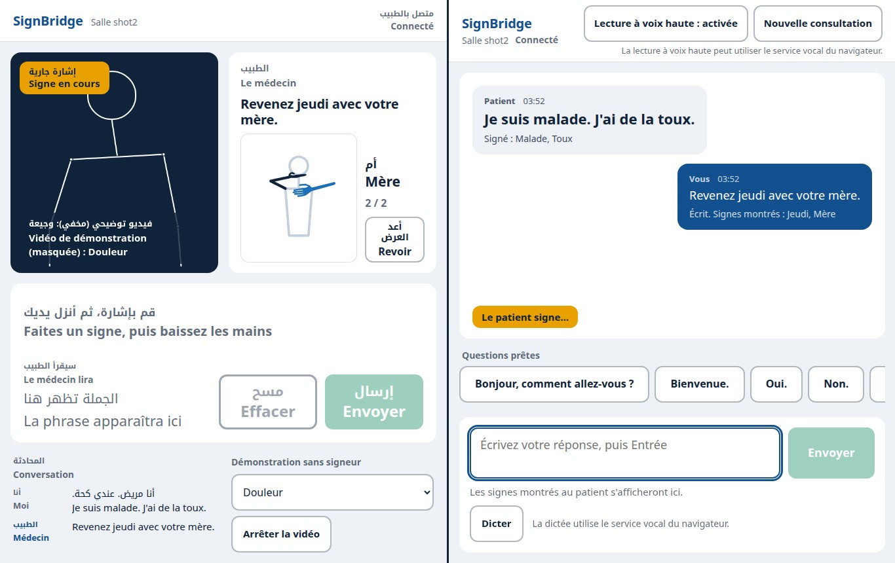

# SignBridge

A deaf patient and a hearing doctor talk in real time, each on their own screen, without an interpreter.

- **The patient signs.** Each sign the camera recognises becomes a word on the patient's screen. The patient builds a sentence from several signs, fixes or removes words, and sends it.
- **The doctor reads and hears it** as a proper French sentence ("Je suis malade. J'ai de la fièvre et de la toux."), then answers by typing, dictating, or choosing a ready-made phrase.
- **The patient sees the answer** in large text, and the signs for it performed by a stick figure, one after another.

Everything runs in the browser on one computer: the camera image is turned into body and hand points, and the sign model reads those points. No camera image is stored or sent anywhere.



## Start it

Python 3 only (standard library); no install for the app itself.

```bash
git clone https://github.com/MohamedYassineAbid/Sign-Bridge.git
```

```bash
cd Sign-Bridge
```

```bash
python3 web/serve.py
```

Open http://localhost:8520 in Chrome or Edge, choose a room name, then:

- **Les deux sur cet écran**: both screens side by side, for a demo on one laptop.
- **Écran du patient** on the laptop with the camera, and **Écran du médecin** on another window or another device, with the same room name.

To let the doctor join from another device on the same network, start the server with `--host 0.0.0.0` and open `http://<laptop address>:8520/doctor.html?room=<room>` there. The patient screen must stay on `localhost` (browsers only give camera access on `localhost` or `https`).

**Demonstration without a signer.** The patient screen has a "Démonstration sans signeur" control: it plays a reference recording of a medical sign through exactly the same recognition path, without showing the person in it, so a presenter can build and send a sentence.

## How a conversation works

| Step | Patient screen | Doctor screen |
|---|---|---|
| The patient signs "malade", lowers the hands, signs "fièvre" | Each recognised sign appears as a word; the last word offers the next two guesses as a correction | "Le patient signe…" |
| The patient presses **Envoyer** | The sentence is sent | "Je suis malade. J'ai de la fièvre." appears and is read aloud |
| The doctor types "Allez à l'hôpital aujourd'hui." | "Le médecin écrit…" | Below the field: the signs the patient will see (Hôpital, Aujourd'hui) |
| The doctor presses **Envoyer** | The text in large letters, and the stick figure signs Hôpital then Aujourd'hui | |

## Where AI is used, and where it is not

| Task | Method | Why |
|---|---|---|
| Find the body and hands in the camera image | MediaPipe Holistic, in the browser | No rule can find a hand in pixels |
| Recognise a sign | A small neural network on the body and hand points | Signs vary with the person, speed and angle |
| Turn the patient's signs into a sentence | Fixed rules (`web/lib/lexicon.js`) | The vocabulary is closed; nothing needs generating |
| Find the signs for the doctor's words | Word matching with synonyms | Predictable, and the doctor sees the result before sending |
| Show a sign to the patient | A stick figure replaying recorded movement (`web/lib/avatar.js`) | No video of a real person is shown |
| Read aloud, dictation | The browser's speech services | Optional; dictation needs the browser's online speech service |

## The signs

- **22 medical signs** (pain, headache, fever, cough, dizziness, diabetes, pregnancy, appointment, medicine, urgent…) in **Spanish Sign Language**, from SWL-LSE: 1,061 recordings by 124 signers. No open Tunisian medical sign dataset exists yet.
- **27 everyday words in Tunisian Sign Language** (bonjour, ça va, oui, non, vouloir, aider, hôpital, dispensaire, maison, family members, the seven days), from the Tunisian Sign Language Dataset made with ATILS.

Every sign can be shown to the patient as a stick figure. Not every sign is recognised from the patient's camera: a sign is proposed only if it was recognised reliably on signers the model never saw (see Results).

## Results

One model recognises both sets: 22 medical signs, 27 Tunisian words and an "other" class. Each set is scored so that it cannot flatter itself.

**Medical signs** (SWL-LSE official test split, signers' identity not checked against training):

| Measure | Result | Clips |
|---|---|---|
| Right sign among all 50 classes | 71.4% | 56 |
| Right sign in the top 3 | 92.9% | 56 |
| As the patient screen works (every proposed sign allowed), replaying held-out recordings frame by frame through the capture | 76% right first time, 15% "sign again", 7% wrong | 125 |

A wrong proposal is not sent: the patient sees the word, with the next two guesses offered as corrections, and can remove it. An earlier model trained on the medical signs alone scored 80.7% ± 1.3 over 5-fold cross-validation.

**Tunisian everyday words** (each of the 7 signers held out in turn, so the model never saw the person it is scored on):

| Word | Right on unseen signers |
|---|---|
| Père | 5 / 5 |
| Frère, Vendredi | 3 / 3 |
| Non | 3 / 4 |
| Mère, Jeudi | 2 / 2 |
| Oui | 2 / 3 |
| All 27 words | 28 / 74 (38%) |

The camera proposes a sign only if it scored at least 70% this way. Six Tunisian words pass (père, frère, vendredi, non, mère, jeudi); "oui" misses by one recording. The other words, and those performed by a single signer in the dataset (bienvenue, ça va, nom, lundi, mardi, mercredi), cannot be recognised reliably yet: they are shown to the patient as stick figures but never proposed from the camera. Among the medical signs, "essoufflement" is also shown but not proposed.

Metrics: `Demo/consultation/models/health_signs.json`.


## Limits

- **The medical signs are Spanish Sign Language.** They are the closest open dataset of health signs. Recording Tunisian medical signs with ATILS and deaf signers is the next step.
- **The Tunisian data is small**: a few seconds of images per word from one to five signers, cropped at the chin. Several words cannot be recognised reliably yet and are only shown, not recognised.
- **One sign at a time.** The patient lowers the hands between signs; continuous signing is not recognised.
- **Lighting and framing matter.** Hand tracking degrades in poor light or when the hands leave the frame.
- **It is not a diagnostic tool.** The sentence rules and the Arabic wording need review by a clinician and a native speaker.
- **Not yet tested on a real webcam with a deaf signer.** Recognition was checked with recorded signs through the same path the camera uses.

## Privacy

- The camera image is turned into body and hand points in memory, then dropped. No image or video is written or sent.
- The relay between the two screens keeps the conversation in memory only, and forgets it when the server stops or the doctor starts a new consultation.
- No name or identity is asked.
- The only data that can leave the computer: the doctor's voice if dictation is used, and the text read aloud if the browser has no French voice installed. Both are labelled on the doctor's screen.

## Project layout

| Path | What it is |
|---|---|
| `web/` | The app: `patient.html`, `doctor.html`, `split.html`, and `serve.py` (static server and relay) |
| `web/lib/` | Tracker, features, capture, model, recogniser, lexicon, avatar, channel, speech |
| `web/data/` | The sign list and the stick-figure movements |
| `web/models/` | The sign model exported for the browser |
| `training/` | Building the datasets, training, exporting |
| `Demo/consultation/` | The Python reference of the recognition code, used by training |
| `Demo/` (other pages) | The earlier Streamlit experiments (text to speech, speech to text, sign to text) |

## Rebuilding the model

Needs `pip install numpy mediapipe==0.10.13 opencv-python-headless` (Python 3.11 or 3.12).

```bash
PYTHONPATH=Demo python -m training.swl_convert
```

```bash
git clone --depth 1 https://github.com/W7CH/First-ever-Tunisian-Sign-Language-Dataset data/tunsl
```

```bash
PYTHONPATH=Demo python -m training.tunisian_signs extract
```

```bash
PYTHONPATH=Demo python -m training.train_combined
```

```bash
PYTHONPATH=Demo python -m training.export_web
```

The first command fetches only the SWL-LSE recordings it needs (about 1,060 of 8,000) and reads them without running any code from the files. The stick figures are rebuilt with `training.export_poses` and `training.tunisian_signs poses`.

## Tests

```bash
node --test web/tests/
```

```bash
PYTHONPATH=Demo python -m pytest
```

## Data and credits

See [ATTRIBUTION.md](ATTRIBUTION.md). SWL-LSE (Universidade de Vigo) and the Tunisian Sign Language Dataset (Chakroun and Jerbi, with ATILS) are both CC BY 4.0. MediaPipe is Apache 2.0.
